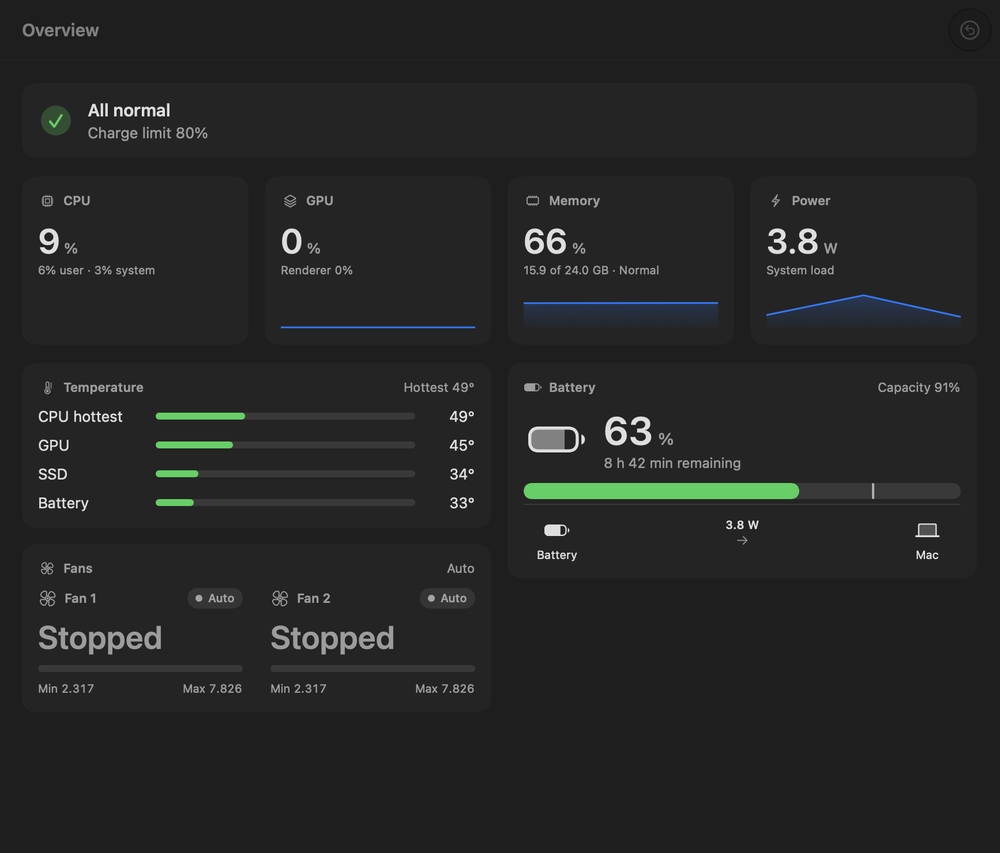
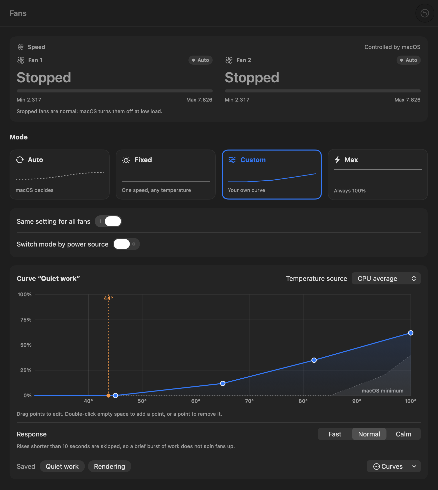
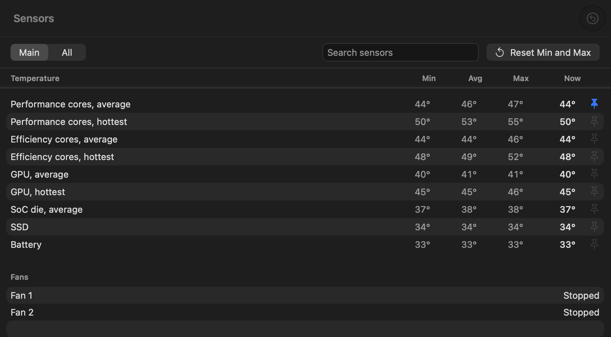
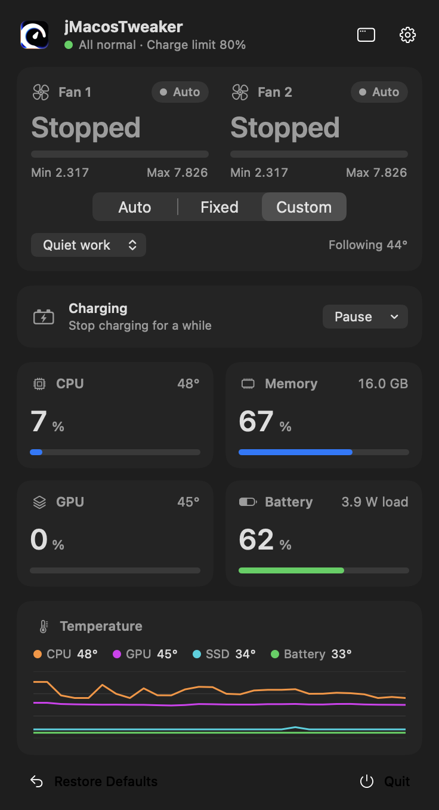

# jMacosTweaker

A native macOS menu bar utility for monitoring, fan control and battery charge limiting. It is restrained, light on
the machine, and designed to fail safe.



| Fans | Sensors | Menu bar |
| --- | --- | --- |
|  |  |  |

> **Status: early.** Monitoring works. Fan control is verified on one Mac. The charge limit uses the macOS setting, so it is limited to 80% and above. Control is **off by default** on any Mac and macOS version not listed in
> [Compatibility](#compatibility).

## What it does

- **Menu bar modules:** CPU, Memory, GPU, Temperature, Fans, Battery, Power, Network and Disk. Each is independent. A module you turn
  off has no menu bar item and is not polled. Styles: text, icon and value, mini bar, sparkline, mini gauge.
- **Sensors:** temperatures, voltages and currents, grouped and searchable, with minimum, average and maximum.
- **Load:** per-core CPU with P-cores and E-cores labeled, memory breakdown and pressure, GPU utilization, average frequencies, network and disk speed,
  and your top processes. All of it is sampled only while visible or enabled.
- **Battery and power:** charge, health, cycles, and how power splits between adapter, system and battery, updated every
  second. Devices the Mac is powering, such as a charging phone, are listed with their draw.
- **Fans (needs helper):** Auto, a fixed speed, your own curves, or Max. Curves follow a sensor you choose, skip short
  temperature spikes (Response: 3, 10 or 30 s), never go below a macOS minimum, and can be saved, imported and exported.
  The menu bar popover switches modes and saved curves.
- **Charge limit:** 80, 85, 90, 95 or 100%, using the macOS setting. Charging stops at the limit and the Mac runs from the
  adapter, without using the battery. Needs no helper. Lower limits are not possible. See
  [Known limitations](#known-limitations).
- **Pause Charging (needs helper):** stop taking charge for a while, for example for an hour or until the battery is at
  50%, when the macOS limit does not hold. The Mac runs from its battery during the pause, so the level goes down.
  Charging comes back at the chosen time or level, at 20% at the latest, before sleep and after a day at most.
- **Appearance:** a native macOS look in light and dark, Liquid Glass on macOS 26 and later, and a graph color that follows
  the system accent color or one you choose.

No telemetry. No network requests, except an optional update check: off by default, it reads the latest version number
from this repository's GitHub releases once a day and shows a notice in the window. It sends nothing about your Mac, and
never downloads or installs anything.

## Requirements

- macOS 14 or later. Developed on Apple Silicon. Intel builds, but is untested.
- To build: Xcode 16 or later and [XcodeGen](https://github.com/yonaskolb/XcodeGen).

## Download

Download the `.dmg` from the [Releases](https://github.com/volodya88i/jMacosTweaker/releases) page and open it.

**Everything in one step (recommended).** Double-click **Install jMacosTweaker.command**. It copies the app to
Applications, installs the [helper](#the-privileged-helper) that fan control needs, and opens the app. Terminal asks for
your password once, for `sudo`; the app itself never asks for it. The image is not notarized, so if macOS will not open
the installer, right-click it and choose **Open**, or allow it under **System Settings > Privacy & Security**. To update,
run the installer from the new image again.

**Monitoring only.**

1. Drag **jMacosTweaker** to **Applications**.
2. This build is not notarized, so macOS blocks it at first. If you trust the download, run:

   ```bash
   xattr -dr com.apple.quarantine /Applications/jMacosTweaker.app
   ```

   If it says `Permission denied`, the helper was installed before. Put `sudo` in front of the command.

3. Open the app. It lives in the menu bar and has no Dock icon.

Monitoring and the charge limit work right away. To add the helper later, use **Install Helper…** in Settings.

## Build and run

You can also build it yourself:

```bash
brew install xcodegen
xcodegen generate
xcodebuild -project jMacosTweaker.xcodeproj -scheme jMacosTweaker -configuration Release -derivedDataPath build/dd build
open build/dd/Build/Products/Release/jMacosTweaker.app
```

Signing is ad-hoc by default, so no Apple account is needed. To use your own certificate, see `Config/Signing.xcconfig`.

### Unsigned builds and Gatekeeper

Release disk images are ad-hoc signed and not notarized, because this project has no paid Apple Developer account. macOS will
block a downloaded copy until you remove the quarantine flag, as shown under [Download](#download).

## The privileged helper

Monitoring and the charge limit need no special access. Fan control changes hardware settings, which requires root, so
it goes through a small daemon that you install yourself. **The app never asks for your password.**

The easiest way is **Install Helper…** in Settings, or on the Fans page. macOS asks for an administrator password in its
own dialog, and the app runs the same install script as below. Before it does, the app checks that its own signature,
scripts included, is intact. The same place has **Update Helper…** after an update and **Remove Helper…**.

Or run the script yourself in Terminal:

```bash
sudo tools/install_helper.sh build/dd/Build/Products/Release/jMacosTweaker.app
```

| Installed | Where |
| --- | --- |
| The app, owned by root | `/Applications/jMacosTweaker.app` |
| The daemon | `/Library/PrivilegedHelperTools/com.jmacostweaker.helper` |
| Its launch configuration | `/Library/LaunchDaemons/com.jmacostweaker.helper.plist` |
| The pinned code hash, restore record and charge policy | `/Library/Application Support/jMacosTweaker/` |

Update the helper after every rebuild or update. The helper only accepts the exact build it pinned, and the app tells you
when this is needed.

## Safety model

The app may only leave the system as safe as the default, or safer. Full details are in [SAFETY.md](SAFETY.md).

- The helper's API is a short list of operations, with no call that takes a key. It can only write a whitelisted set of
  fan and charge keys.
- If the app quits, crashes or hangs, or the Mac sleeps, or a sensor fails, or a write fails, fans return to system
  control.
- A thermal supervisor overrides every preset and cannot be turned off. It acts on heat that lasts 10 s, or at once on
  a critical reading, and raises fans in steps.
- No curve or Fixed speed can cool less than macOS does: the helper raises it to a floor that follows the hottest CPU
  or GPU, and the curve editor shows that floor as a shaded zone.
- Fan speeds are clamped to the limits the hardware reports. Every write is read back.
- Charging is never inhibited at or below 20%, or when battery state is unreadable.
- Changes are journaled before they are made, so they can be undone after a crash.
- If another tool that writes the same settings is running, control stays off and the app names the tool.

**Known weakness:** without a Developer ID, the helper cannot check a developer signature. It relies on a pinned code
hash and a root-owned install path instead. See [SAFETY.md](SAFETY.md#known-weaknesses).

## Compatibility

Only what has actually been checked is listed here.

| Mac | macOS | Monitoring | Fan control | Charge limit | Pause Charging |
| --- | --- | --- | --- | --- | --- |
| MacBook Pro, M4 Pro (Mac16,8) | 27.2 | Works, including adapter figures | Works: both fans, Fixed speed and curves. Sleep and the thermal override not yet checked on hardware | Works through the macOS setting: 80 to 100%, holding on the adapter | The key it uses was tested by hand: it sets the adapter aside within about 3 s and brings it back within seconds. The feature itself is new |

Sensor names come from observation, not from Apple. Temperature groups were identified on this one Mac by watching
which sensors respond to CPU and GPU load, and the raw key stays visible in each name.

## Known limitations

- Manual control takes about 5 seconds to start, because the hardware refuses it until the fans have spun up.
- The lowest manual speed is the hardware minimum (2,317 rpm on the tested Mac). Only macOS can stop the fans, in Auto.
- Sensors cannot be tied to individual CPU cores. A load test could not establish the mapping, so the app shows cluster
  averages and hottest values instead.
- Charge limits below 80% are not possible on the tested Mac. macOS accepts only 80, 85, 90, 95 and 100%. The keys in
  older material do not exist, and the one writable charge key (`CHIE`) cuts the adapter, so the battery would drain
  rather than hold. Heat protection and top up are not offered for the same reason. That draining is what Pause
  Charging uses on purpose.
- On a macOS version without a built-in charge limit, no limit is offered. Keys for older Macs have not been tested, so
  they are not used. [Reports](https://github.com/volodya88i/jMacosTweaker/issues) from owners of those Macs are welcome.
- The charge limit uses a private macOS interface, which an update could change. The control then disappears, and the
  setting in System Settings keeps working.
- Discharge to limit on adapter is not offered, because no key for it has been verified.
- How charge inhibition behaves across shutdown is unknown.
- There is no ambient temperature, because no sensor could be verified as ambient.
- Accessory power is verified with one iPhone on one port. Drives, hubs and docks have not been tried, and a device that
  does not report its power gets no row.
- Top processes shows what the app can read without root, which can leave out some system processes.
- After a restart, fan control can take a little while to become available, because macOS starts the helper along with
  its other daemons. Fans stay under system control until then.
- VoiceOver and the helper refusing a wrong client have not been checked on hardware.

## Removing leftovers from other tools

Deleting a fan or battery app does not remove its background helper. That helper runs as root and can write the same
settings even with the app gone, so jMacosTweaker may warn about it or keep fan control off.

If you still have the other app, use its own uninstaller first. Otherwise, remove the helper with these commands, using the
label from the table:

```bash
LABEL=com.crystalidea.macsfancontrol.smcwrite
sudo launchctl bootout system/$LABEL
sudo rm /Library/LaunchDaemons/$LABEL.plist
sudo rm /Library/PrivilegedHelperTools/$LABEL
```

| Tool | Label |
| --- | --- |
| Macs Fan Control | `com.crystalidea.macsfancontrol.smcwrite` |
| AlDente Pro | `com.apphousekitchen.aldente-pro.helper` |

`bootout` reports an error if the helper is not loaded, which is fine. Run the `rm` lines anyway. Then reopen jMacosTweaker.
Restart the Mac if fans or charging do not return to normal. These paths were seen on one Mac and can differ between
versions of those tools, so check that a path exists if a command cannot find it.

## Restore and uninstall

**Restore System Defaults** is in the toolbar of every page of the window, and at the bottom of each menu bar popover. To
remove everything:

1. In Settings, under Privileged Helper, choose **Restore Defaults and Prepare Uninstall**.
2. Run the command it shows:

```bash
sudo tools/uninstall_helper.sh --remove-app
```

## FAQ

**Why is fan control grayed out?** The app says why on the Fans page. Usually the helper is not installed, another fan
tool is running, or control has not been verified on your Mac and macOS version.

**Why do my fans read 0 rpm?** macOS can stop the fans completely at low load.

**Why does macOS stop charging below my limit?** Optimized Battery Charging and the limit in System Settings work on
their own, and can stop charging first.

**Is it safe?** It is designed to fail safe, and that design is tested against simulated hardware. Nothing can
guarantee safety on undocumented hardware interfaces. You use it at your own risk, as the license states.

## License

MIT with the Commons Clause. See [LICENSE](LICENSE). You can use, change and share the code for free, including at work,
but you cannot sell it or a product or service that gets its value mainly from it. This restriction means it is
source-available, not open source by the OSI definition.
